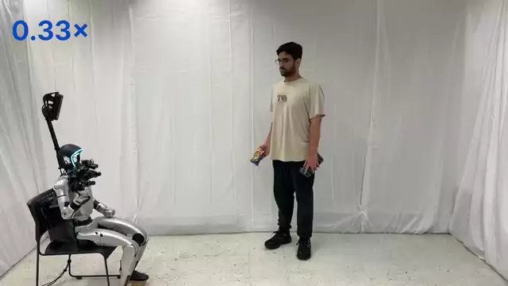

# Catch It All!: Generalizable Dynamic Catching with a Dexterous Hand

[Paper](https://arth-shukla.github.io/catch-it-all/static/catch_it_all.pdf) | [arXiv](https://arxiv.org/abs/2610.39044) | [Website](https://arth-shukla.github.io/catch-it-all/) | [Video](https://arth-shukla.github.io/catch-it-all/#video)

<a href="https://arth-shukla.github.io/catch-it-all/"></a>

Code for training and evaluating the catching policies from *Catch It All!* in simulation.

## Installation

```bash
git clone https://github.com/arth-shukla/catch-it-all.git
cd catch-it-all
```

IsaacGym needs Python 3.8, so training and IsaacGym evaluation use one environment and MuJoCo evaluation uses another.

### IsaacGym (training and IsaacGym evaluation)

```bash
conda create -n humanoid_isaacgym python=3.8
conda activate humanoid_isaacgym

# IsaacGym
wget https://developer.nvidia.com/isaac-gym-preview-4 -O isaac.tar.gz
tar -xzf isaac.tar.gz -C .
pip install -e isaacgym/python

# verify IsaacGym is installed
python isaacgym/python/examples/1080_balls_of_solitude.py

# this repo
pip install -e .[dev]
```

### MuJoCo (sim2sim evaluation)

SAM2 is only needed to evaluate the student in MuJoCo with object positions tracked by SAM2 on rendered camera images (see below).

```bash
conda create -n humanoid python=3.10
conda activate humanoid

# SAM2
git submodule update --init segment-anything-2-real-time
cd segment-anything-2-real-time/checkpoints
bash download_ckpts.sh
cd ../..
mkdir -p resources/models
cp segment-anything-2-real-time/checkpoints/sam2.1_hiera_tiny.pt resources/models/sam2.1_hiera_tiny.pt
pip install -e segment-anything-2-real-time

# this repo
pip install -e .[dev]
```

## Setup

Run all scripts from the repo root.

Training logs to Weights & Biases by default. Either run `wandb login` and set `ENTITY` at the top of each training script to your W&B entity, or set `LOG_ONLINE=False` to log to TensorBoard only. Runs are saved to `humanoid_exps/`.

Pretrained teacher and student checkpoints for both catching styles are in `humanoid_checkpoints/`.

## Training

### 1. Teacher (PPO-LSTM)

PPO training is adapted from [RSL-RL](https://github.com/leggedrobotics/rsl_rl).

```bash
conda activate humanoid_isaacgym

# underhand
bash scripts/ppo_lstm/train_ppo_lstm_humanoidverse_clipact_catch_upper.sh

# overhand
bash scripts/ppo_lstm/train_ppo_lstm_humanoidverse_clipact_catch_upper-overhand.sh
```

Checkpoints are written to `humanoid_exps/<env_id>/ppo_lstm/<exp_name>/models/`. Rerunning a script resumes from `latest.pt`.

### 2. Student (DAgger)

Each DAgger script reads its teacher from `CKPT_PATH` at the top of the script. By default this points to the provided teachers in `humanoid_checkpoints/`, however other checkpoints can be used instead.

```bash
conda activate humanoid_isaacgym

# underhand
bash scripts/dagger/train_dagger_humanoidverse_clipact_catch_upper.sh

# overhand
bash scripts/dagger/train_dagger_humanoidverse_clipact_catch_upper-overhand.sh
```

## Evaluation

Set `TOSS_TYPE` (`underhand` or `overhand`) and `CKPT_PATH` at the top of each script. By default they evaluate the provided checkpoints.

```bash
# IsaacGym
conda activate humanoid_isaacgym
bash scripts/evaluate/evaluate_humanoidverse_catch_upper.sh       # teacher
bash scripts/evaluate/evaluate_humanoidverse_catch_upper_hist.sh  # student

# MuJoCo (sim2sim)
conda activate humanoid
bash scripts/evaluate/evaluate_mujoco_catch_upper.sh            # teacher
bash scripts/evaluate/evaluate_mujoco_catch_upper_hist.sh       # student
bash scripts/evaluate/evaluate_mujoco_catch_upper_hist_sam2.sh  # student, SAM2 object tracking
```

**Sim-to-Sim Evaluation with SAM2 Observations.** The object observation a policy receives is set by `obs_dict.actor_obs` in its observation config (`humanoid/envs/humanoidverse/config/catching/catch_upper/observation/`). By default the student receives `obj_pos_wrt_camera_noisy`: the ground-truth object position in the camera frame with the same noise, dropout, and latency model used in IsaacGym. To evaluate in MuJoCo with positions tracked by SAM2 on rendered camera images instead, run `scripts/evaluate/evaluate_mujoco_catch_upper_hist_sam2.sh`, which replaces it with `obj_pos_wrt_camera_noisy_sam2` in both `obs_dict.actor_obs` and `obs_auxiliary.history_actor`. Each env loads its own SAM2 model, which requires more VRAM.

## Citation

```bibtex
@misc{shukla2026catchallgeneralizabledynamic,
  title         = {Catch It All!: Generalizable Dynamic Catching with a Dexterous Hand},
  author        = {Arth Shukla and Kehlani Fay and Huaze Liu and Darin Djapri and Alexiy Buynitsky and Nicklas Hansen},
  year          = {2026},
  eprint        = {2610.39044},
  archivePrefix = {arXiv},
  primaryClass  = {cs.RO},
  url           = {https://arxiv.org/abs/2610.39044},
}
```
